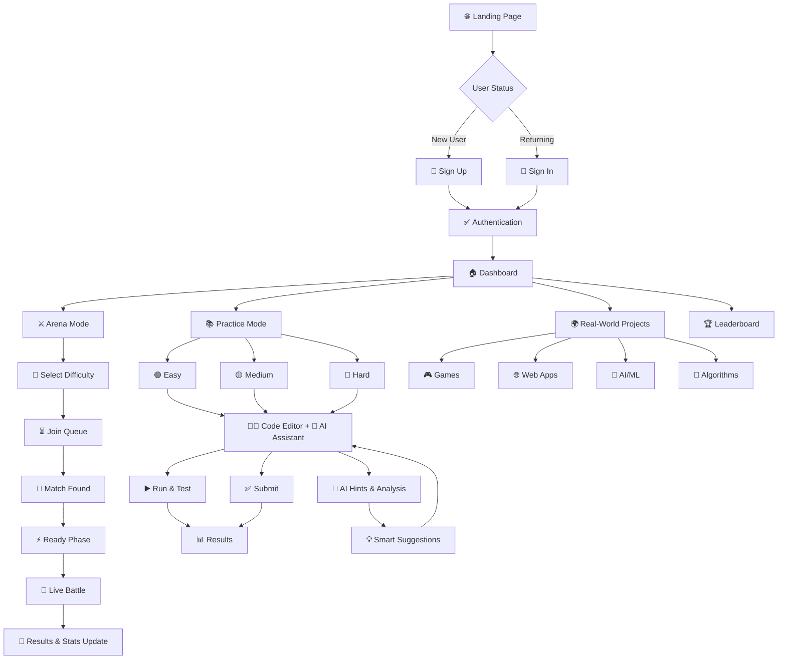

# ⚔️ CodeBattle Arena — Real-Time Competitive Coding Platform

**CodeBattle Arena** is a competitive programming platform featuring real-time 1v1 coding duels, practice modes, and AI-assisted learning. Built for scalability with modern web technologies.

## 🎮 Features

### ⚔️ **Arena Mode - Real-Time PvP Battles**
- Live 1v1 coding duels with WebSocket-powered real-time updates
- Independent player progression (separate timers & question flows)
- Smart matchmaking system based on skill level
- Dynamic scoring: 10 points per test case + 5 bonus for complete solutions
- 5-question rounds with auto-advancement

### 🤖 **AI-Powered Assistance**
 Real-time code analysis with Google Gemini AI
 VS Code-style visual indicators (lightbulbs, error/warning icons)
 Per-line and full-program suggestions for beginners
 Test-aware intelligence: disables when all tests pass, re-enables on code changes
 Context-aware hints and debugging assistance
 Advanced UI feedback: clickable lightbulb annotations, test fix suggestions, and real-time code decorations for improved beginner experience

### 📚 **Practice Modes**
- **Easy/Medium/Hard**: Tiered difficulty levels (5min/8min/15min)
- **Categories**: Arrays, Algorithms, Mathematics, Data Structures
- **Real-World Projects**: Games, Web Apps, AI/ML, IoT challenges
- Multi-language support (JavaScript, Python, C++, Java)

### 📐 **Aptitude Arena (Placement & Competitive Prep)**
- **3 Core Categories**:
  - **Quantitative Aptitude (25 Topics)**: Speed, Time and Distance, Algebra, Geometry, Probability, Number System, Permutation & Combinations, Interest, etc.
  - **Logical Reasoning (14 Topics)**: Clocks, Calendar, Blood Relations, Syllogisms, Puzzles, Coding Decoding, Seating Arrangement, etc.
  - **Verbal Ability (8 Topics)**: Ordering of Words/Sentences, Spotting Errors, Sentence Correction, Idioms & Phrases, Synonyms & Antonyms.
- **Pre-Learning & Formula Cheat-Sheets**: Deep-dive theoretical guides, mathematical derivations, harmonic vs arithmetic speed means, time-saving shortcuts, and FAQ sections.
- **80% Mastery Progression**: 4 Practice Sets per topic; Set $N+1$ unlocks **if and only if** Set $N$ is completed with $\ge 80\%$ score. Scoring $< 80\%$ redirects the candidate to the concept review guide.
- **🛡️ Safe Exam Mode (Mock Tests)**:
  - Strict full-screen lockdown.
  - Tab switch & window blur detection with warning alerts (2 free warnings, followed by $-0.5\text{ pts}$ deduction per excess violation).
  - Inspection barrier (disabled context menus, clipboard actions, and devtools shortcuts).
- **Server-Side Grading & Negative Marking**: Zero answer leakage (answers never sent to client during tests) with $-0.25$ negative marking per incorrect answer.
- **Dedicated Leaderboard**: Real-time rankings sorted by Net Score, Accuracy, and Time Taken.

### 🏆 **User System & Analytics**
- Clerk authentication with secure session management
- Real-time arena leaderboards and global practice rankings
- Comprehensive statistics: win rates, streaks, match history
- Personal analytics: performance insights, difficulty progress
- Arena player stats with ELO-style ranking system

---

## 🛠️ Tech Stack

### **Frontend**
- **Languages**: HTML5, CSS3, JavaScript (ES6+)
- **Editor**: ACE Code Editor with syntax highlighting
- **Architecture**: Modular design (7 specialized modules)
- **Real-time**: Socket.IO client for WebSocket communication
- **UI**: Responsive design with dark/light themes

### **Backend**
- **Runtime**: Node.js + Express.js (RESTful APIs)
- **Database**: MongoDB + Mongoose ODM
- **Real-time**: Socket.IO for WebSocket communication
- **Code Execution**: Piston API (40+ language support)
- **Authentication**: Clerk integration
- **AI Engine**: Google Gemini 2.0 Flash for code assistance

### **External Services**
- **Clerk**: User management & authentication
- **Piston API**: Secure code execution sandbox
- **MongoDB Atlas**: Cloud database hosting
- **Google Gemini AI**: Intelligent code assistance

---

## 🎯 User Navigation Flow



---

## 🚀 Quick Start

```bash
# Clone repository
git clone https://github.com/vikashgupta16/CodeBattle-Arena.git
cd CodeBattle-Arena

# Install dependencies
npm install

# Set up environment variables (.env)
MONGODB_URI=mongodb://localhost:27017/codebattle-arena
CLERK_PUBLISHABLE_KEY=your_clerk_key
GEMINI_API_KEY=your_gemini_api_key
AI_ASSISTANCE_ENABLED=true
PORT=8080

# Seed database and start
npm run seed
npm run dev
```

## 📁 Project Structure

```
CodeBattle-Arena/
├── client/
│   ├── public/          # Landing page, auth
│   └── private/         # Authenticated areas
│       ├── Aptitude/    # Aptitude Arena (Quant, Logic, Verbal, Exam Engine)
│       ├── Arena/       # Real-time battle mode (7 modules)
│       ├── HomePage/    # Dashboard with stats
│       ├── CoderPage/   # Practice mode
│       ├── Leaderboard/ # Rankings & leaderboards
│       ├── common/      # Shared utilities (AI assistance)
│       └── Easy/Intermediate/Advanced/  # Difficulty levels
└── server/
    ├── index.js         # Main server & REST endpoints
    ├── aptitudeDatabase.js # Aptitude LLD, grading & leaderboard
    ├── seedAptitude.js  # Seeder for 47 topics, cheat-sheets & 30-MCQ sets
    ├── testAptitude.js  # Automated SDE test suite
    ├── arenaSocket.js   # WebSocket handlers
    ├── arenaDatabase.js # Match & stats management
    ├── aiAssistance.js  # Gemini AI integration
    └── problemDatabase.js # Problems & submissions
```

---

## 🚀 CI/CD Pipeline

### **GitHub Actions Workflow**
Automated testing, building, and deployment pipeline:

- **🧪 Testing**: Automated unit tests on pull requests
- **🔍 Code Quality**: ESLint and code formatting checks
- **🚀 Auto-Deploy**: Automatic deployment to Render on main branch
- **📦 Dependency Security**: Vulnerability scanning

### **Deployment Commands**
```bash
# Production deployment
npm start                    # Uses: node server/index.js

# Development
npm run dev                  # Uses: nodemon server/index.js

# Database seeding
npm run seed                 # Initialize with sample problems
```

📋 **For detailed deployment instructions, see [DEPLOYMENT.md](DEPLOYMENT.md)**

---

## 📄 License & Authors

**GPL-3.0-or-later** © 2025

**Authors:**
- [Rouvik Maji](https://github.com/Rouvik) - Database Design
- [Archisman Pal](https://github.com/Dealer-09) - Backend & Architecture
- [Vikash Gupta](https://github.com/vikashgupta16) -  Frontend & UI/UX
- [Rajbeer Saha](https://github.com/pixelpioneer404) - Frontend & UI/UX
